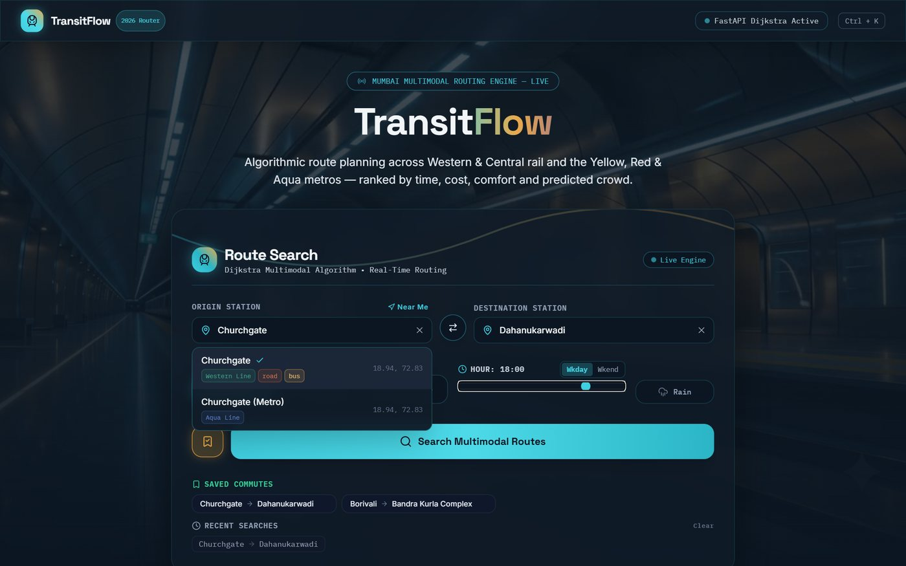
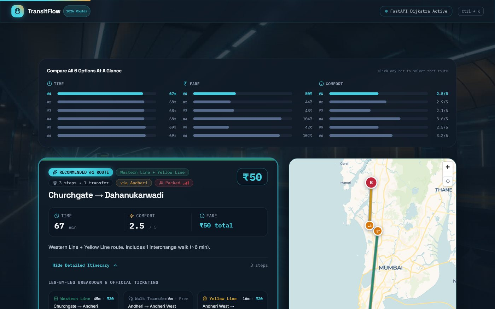
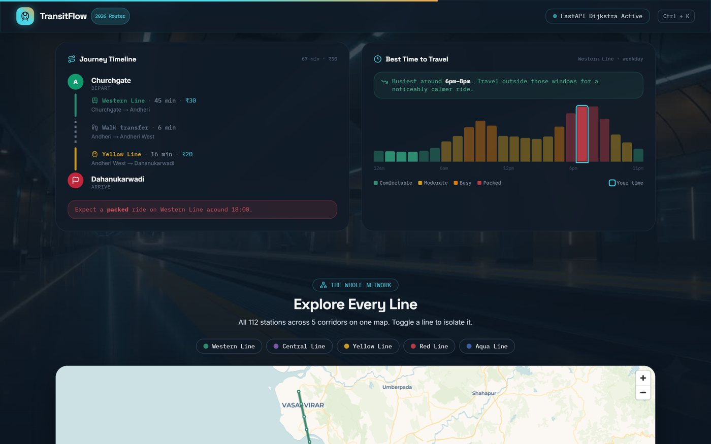
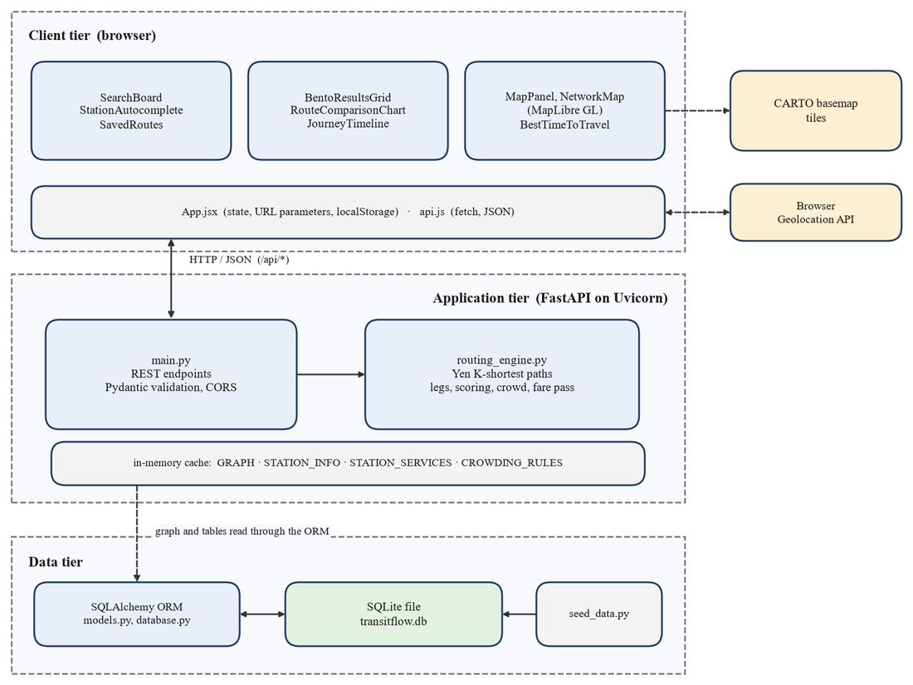

# TransitFlow

A multi-criteria route comparison system for Mumbai's public transit. Give it an origin, a destination and what matters to you (fastest, cheapest or most comfortable) and it returns several genuinely different journeys across suburban rail, metro, bus and road, each with time, fare, comfort, a predicted crowd level, a step-by-step itinerary and a map.

TransitFlow is a Third Year Mini Project (Semester V, 2026-27) for the Department of Computer Engineering, Sardar Patel Institute of Technology, Mumbai. It ties together four subjects: discrete structures and graph theory, design and analysis of algorithms, data structures, and database management systems.



## What it does

- Searches **112 stations** on five corridors: Western Line, Central Line and Metro lines 2A (Yellow), 7 (Red) and 3 (Aqua), plus a bus and road corridor and 19 walking interchanges.
- Models the network as a layered directed multigraph where every node is a `(station, mode)` pair, so changing between train, metro and bus costs time.
- Uses Yen's k-shortest-paths (repeated Dijkstra) on three weightings (time, cost, comfort) to find alternatives that actually differ, for example changing at Andheri versus at Malad, instead of one best path.
- Ranks the results by the priority you picked, then applies rain and rush-hour crowd adjustments.
- Predicts a crowd level (Comfortable, Moderate, Busy, Packed) and draws a 24-hour crowd curve so you can see when the same trip is quieter.
- Shows a monthly-pass break-even estimate, a journey timeline, an interactive route map and a map of the whole network.
- Works from the browser alone for personal data: saved routes and recent searches live in `localStorage`, searches are shareable through URL parameters, and `Ctrl+K` opens a command palette.

| Comparison and route card | Best time to travel |
| --- | --- |
|  |  |

## How it is built



| Layer | Technology |
| --- | --- |
| Frontend | React 19, Vite, Tailwind CSS, Framer Motion, MapLibre GL, Lenis |
| Backend | Python, FastAPI, Uvicorn, Pydantic |
| Routing | NetworkX (`MultiDiGraph`, `shortest_simple_paths`) |
| Data | SQLite through the SQLAlchemy ORM (swap `DATABASE_URL` for PostgreSQL) |
| Tests | pytest with FastAPI's `TestClient` |

Stations, edges, interchanges and crowding rules live in four tables. The graph and crowding rules are read once at start-up and kept in memory, so a route request does not touch the database.

## Running it locally

You need Python 3.10 or newer and a current Node.js LTS.

**Backend** (from the `backend` folder, because the SQLite path is relative):

```bash
cd backend
python -m venv venv
source venv/bin/activate          # Windows PowerShell: venv\Scripts\Activate.ps1
pip install -r requirements.txt
python -m app.seed_data           # optional: rebuilds transitflow.db from seed_data.py
python -m uvicorn app.main:app --port 8000
```

Interactive API docs are then at <http://127.0.0.1:8000/docs>.

**Frontend** (second terminal):

```bash
cd frontend
npm install
npm run dev                       # http://localhost:5173
```

The frontend calls `http://127.0.0.1:8000/api` by default. Set `VITE_API_URL` to point it somewhere else. After restarting the dev server, hard-refresh the browser (Ctrl+Shift+R).

## API

| Method | Path | Purpose |
| --- | --- | --- |
| GET | `/api/` | Health check and station count |
| GET | `/api/stations` | Every station with coordinates and the lines that serve it |
| GET | `/api/network` | Line segments and stations for the overview map |
| POST | `/api/route` | Ranked route options for a journey |

```bash
curl -X POST http://127.0.0.1:8000/api/route \
  -H "Content-Type: application/json" \
  -d '{"origin":"andheri","destination":"churchgate","priority":"fastest","is_raining":false,"hour":9,"day_type":"weekday"}'
```

`priority` is `fastest`, `cheapest` or `comfortable`, `hour` is 0 to 23, `day_type` is `weekday` or `weekend`. Anything else is rejected with HTTP 422. Unknown or identical stations return 400, and a pair with no route returns 404. Each option in the response carries `time_minutes`, `cost_rupees`, `comfort_score`, `legs`, `via`, a `crowd_forecast` with the 24-hour curve, and a `fare_pass` insight.

## Tests and benchmarks

```bash
cd backend
pip install -r requirements-dev.txt
pytest                                           # 68 tests, about a second
python benchmarks/benchmark.py engine            # in-process latency
python benchmarks/benchmark.py sweep --pairs 0   # every ordered station pair
python benchmarks/benchmark.py load --levels 1 5 10 25 50 --pid <server pid>
python benchmarks/profile_breakdown.py           # where request time goes
```

Measured on one development laptop (Intel Core i7-12700H, Windows 11, Python 3.14): all 12,432 ordered station pairs return at least one route with a median engine time of 4.9 ms and a 95th percentile of 13.5 ms. A single Uvicorn worker sustains about 46 requests per second on a mixed workload and four workers about 120. These are local numbers, not a production capacity claim. The full method and results are in the project report.

## Repository layout

```
backend/
  app/            FastAPI app, routing engine, ORM models, seed data
  tests/          pytest suite (unit and API tests)
  benchmarks/     latency, load and profiling scripts
  transitflow.db  seeded SQLite database
frontend/         React app that vercel.json deploys
frontend_new/     alternative "indicator board" interface, kept for reference
docs/             project overview, abstract and images used in this README
vercel.json       frontend + backend service configuration for Vercel
```

## Limits to be aware of

- Station coordinates are linearly interpolated between a few real anchor points per line, not surveyed GPS positions.
- Fares and travel times are calibrated estimates, not operator data, and there are no timetables or live delays.
- Crowd levels come from a rule-based model, not live passenger counts.
- Only the five lines above plus a core bus and road corridor are modelled, not all of Mumbai's transit.
- The schema is not fully normalised and declares no foreign keys.

## Team

Group 57, Computer Engineering, SPIT (2026-27): Yaadi Chhadva, Akshit Sharma, Rahil Shah. Guide: Prof. Pramod Bide.

No open-source licence has been chosen for this academic project yet.
