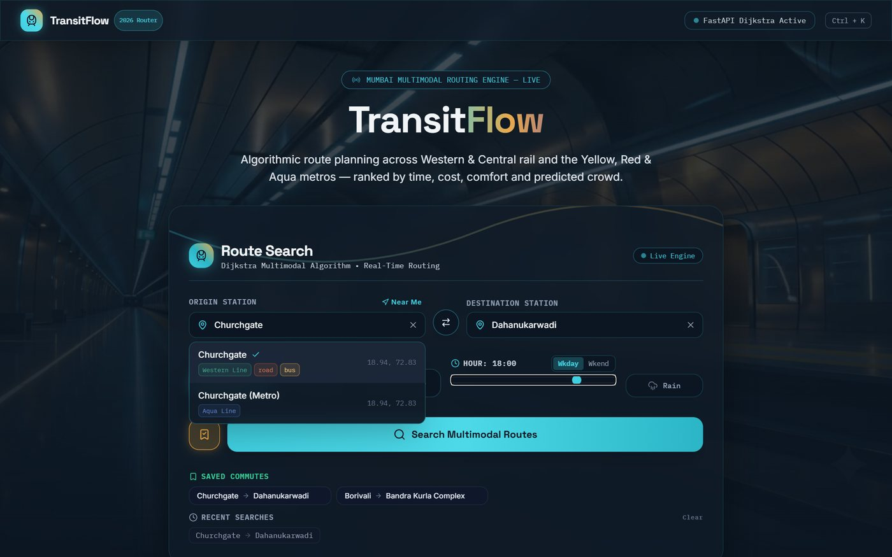
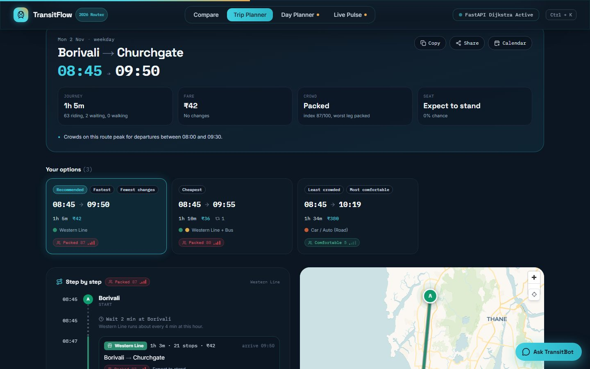
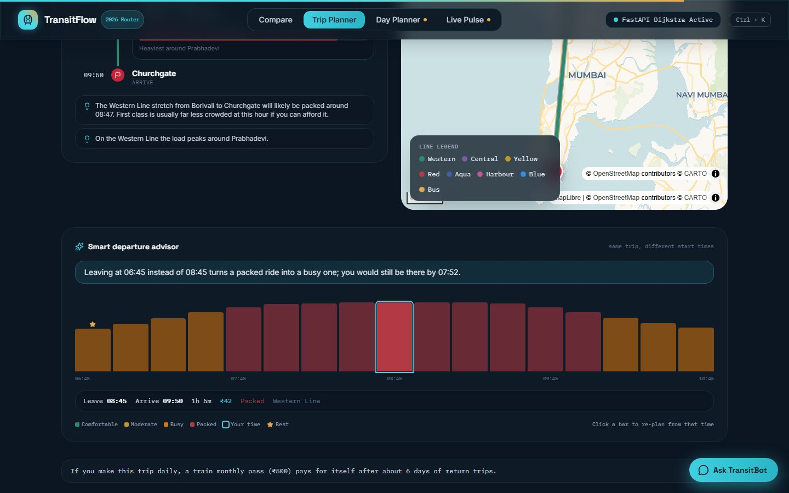
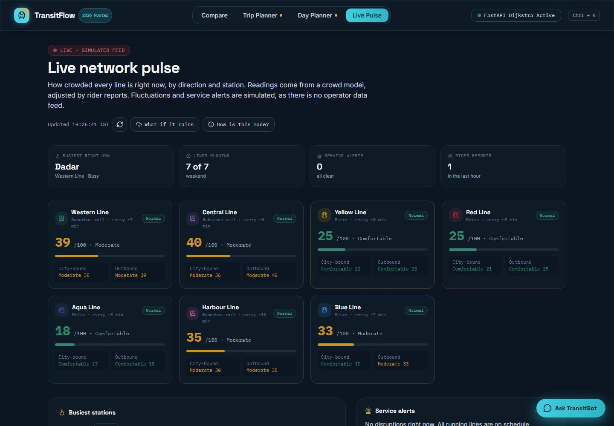
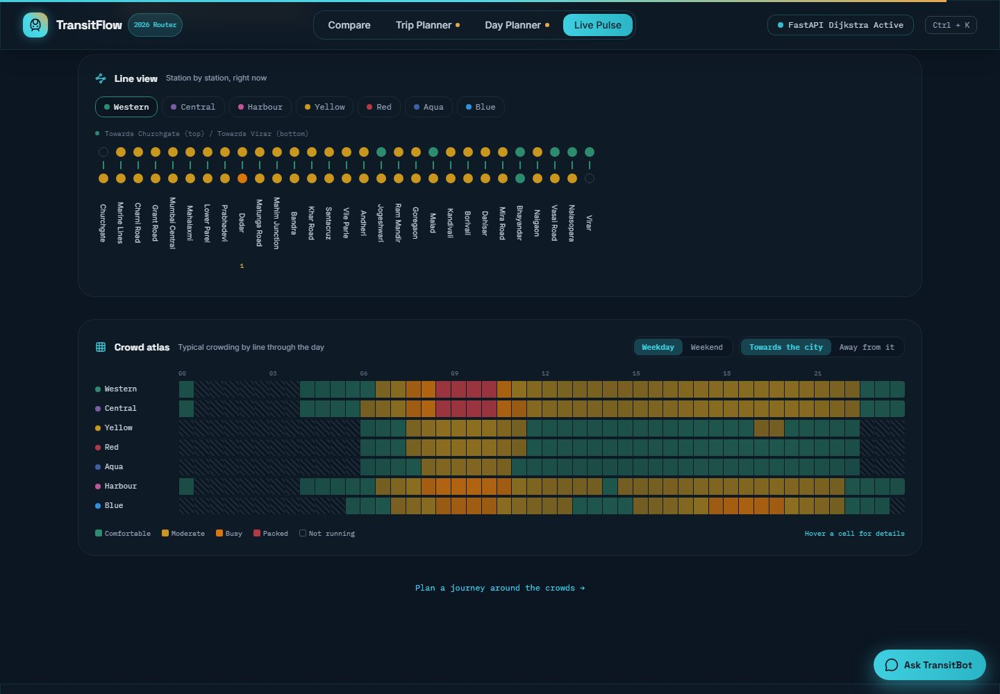
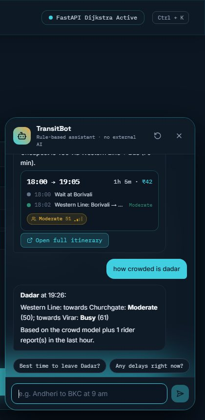
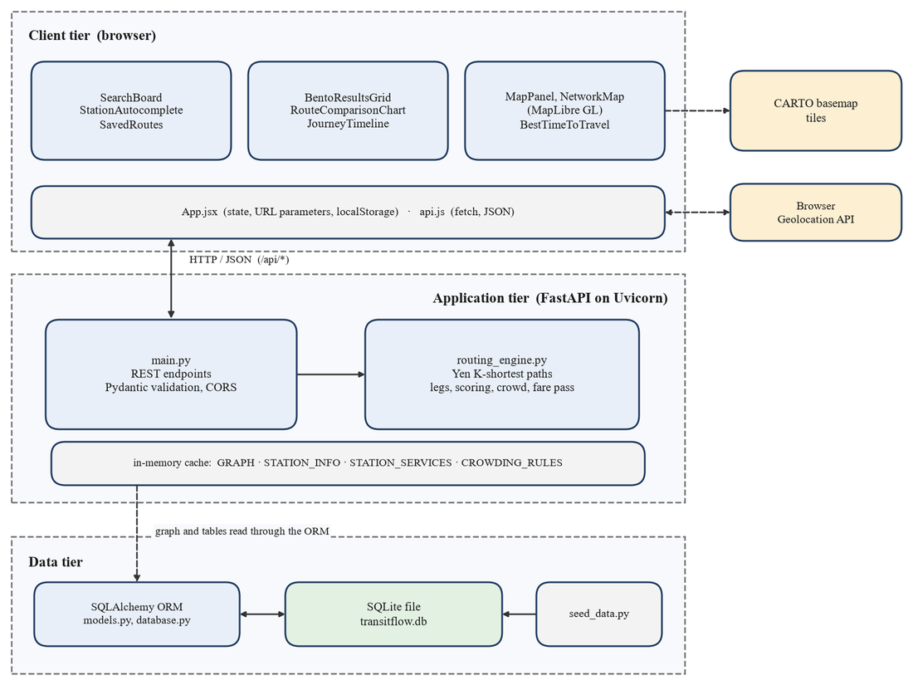

# TransitFlow

A journey planner for Mumbai's public transit. It compares routes across suburban rail, metro, bus and road, then goes further: it places a journey on the clock for any day and time, forecasts how crowded every leg will be, tells you the best moment to leave, plans a whole day of trips, shows a live view of the network, and answers questions in plain language.

**Live prototype:** <https://transit-flow-seven.vercel.app> (the API is under `/api`, for example <https://transit-flow-seven.vercel.app/api/>).

TransitFlow is a Third Year Mini Project (Semester V, 2026-27) for the Department of Computer Engineering, Sardar Patel Institute of Technology, Mumbai. It ties together discrete structures and graph theory, design and analysis of algorithms, data structures, and database management systems.



## What it does

**Route comparison** (the original app, the *Compare* tab)

- Searches **149 stations** on seven lines: Western, Central and Harbour rail, and Metro lines 2A (Yellow), 7 (Red), 3 (Aqua) and 1 (Blue), plus a bus and road corridor and 28 walking interchanges. The Harbour Line reaches Navi Mumbai (Vashi, Nerul, Belapur, Panvel).
- Models the network as a layered directed multigraph where every node is a `(station, mode)` pair, so changing between train, metro and bus costs time.
- Uses Yen's k-shortest-paths (repeated Dijkstra) on three weightings (time, cost, comfort) to find alternatives that actually differ, instead of one best path.
- Shows a monthly-pass break-even estimate, a journey timeline, an interactive route map and a map of the whole network.
- The route map opens in a tilted **3D view** with extruded buildings at street-level zoom, and has a **full-screen** button (press Esc to leave it).

**Network resilience** (new, in the *Compare* tab)

- **Disruption simulator**: below the search board, close whole lines or individual stations, then search again. The router rebuilds the network without them and finds the best remaining route, or reports that none exists. Origin and destination can't be closed stations.
- **Resilience report**: ranks every station by betweenness centrality (how many shortest journeys pass through it) and lists the single points of failure, the stations whose closure disconnects part of the network, with how many stations each would cut off.
- A closed station is removed completely: nothing can board, alight, change or pass through it. Real operators usually let trains run through a closed station, so this is a harsher model than reality (see limits).

**Trip Planner** (new)

- Pick a day and a time, either *leave at* or *arrive by*, and get an itinerary on the clock: wait for the next service, ride, walk, change, arrive, each with its time.
- Crowd is forecast **per leg, at the minute that leg is ridden**, with a seat-chance estimate and the stretch where the load peaks.
- Six preferences: smart pick (time, fare, crowd and changes weighed together), fastest, cheapest, comfortable, least crowded, fewest changes. The best option for each is shown side by side.
- **Departure advisor**: the same trip evaluated for departures two hours either side, so you can see when it is calmer and what leaving earlier or later would cost you.
- Respects service hours (it waits for the first train if you plan for 3 am), models headways, and lets you avoid buses or cabs.
- Real **rain forecast** for the planned hour from Open-Meteo (no key), or choose rain or dry yourself.
- Copy as text, share as a link, or download a calendar file.




**Day Planner** (new): chain home, office, gym and back into one timed schedule. Stops can be "stay for 2 hours" or "leave at 18:00". Each trip is forecast for the moment it happens, and the day shows total fares, minutes in busy trains and whether a monthly pass would pay off.

**Live Pulse** (new)

- Crowd and service status for every line, split by direction, plus the busiest stations, a station-by-station view of any line, and a crowd atlas heatmap (line by half-hour, weekday or weekend, towards or away from the city).
- Riders can **report the crowd** at a station. Reports are stored in a table and blended into that station's reading, newer ones counting more.
- Refreshes every 20 seconds and pauses when the tab is hidden.




**TransitBot** (new): a chat assistant in the corner of every page. Ask "Borivali to Churchgate tomorrow 8:45 am", "how crowded is Dadar", "best time to go from Andheri to BKC", "cheapest way from Thane to Vashi", "any delays?" or "last train on the Harbour Line". It tolerates typos (`borivli to churchgat`), understands times, dates and "arrive by", and keeps context for follow-ups such as "what about 6 pm?" or "if it rains?". It is rule-based, with no external AI service, API key or cost.



Also: saved routes and recent searches in `localStorage`, shareable URLs, a `Ctrl+K` command palette, and an installable PWA.

## How the crowd model works

There is no passenger-count feed for Mumbai's trains, so crowd levels are a model, not a measurement. The model (`backend/app/crowd_model.py`) combines:

1. **Time of day at minute resolution**, interpolated from the hourly rhythm stored in the `crowding_rules` table (separate weekday and weekend curves).
2. **Direction**: morning flow is heavy towards the city end of each line (Churchgate, CSMT, Cuffe Parade) and evening flow heavy away from it. The counter-peak direction runs far emptier. Direction comes from the station order on each line.
3. **Position along the line**: load builds as riders board, peaks about three quarters of the way to the city (the Dadar / Bandra stretch on Western, Kurla to Dadar on Central) and eases at the end.
4. **Line character**: trunk suburban lines run fuller than the newer metros even off-peak. Metro 1, which connects two suburbs, has no inbound direction.
5. **Rain**, which pushes riders from roads onto rail and metro.

On top, the live layer adds rider reports (real, user-supplied), small deterministic fluctuations, and occasional service alerts. **The fluctuations and alerts are simulated** and labelled as such everywhere they appear, because there is no operator data feed.

## How it is built



| Layer | Technology |
| --- | --- |
| Frontend | React 19, Vite, Tailwind CSS, Framer Motion, MapLibre GL, Lenis |
| Backend | Python, FastAPI, Uvicorn, Pydantic |
| Routing | NetworkX (`MultiDiGraph`, `shortest_simple_paths`) |
| Planner and crowd model | Pure Python, deterministic, no external services |
| Data | SQLite through the SQLAlchemy ORM (swap `DATABASE_URL` for PostgreSQL); a separate state database for rider reports |
| Weather | Open-Meteo forecast API, called from the browser |
| Tests | pytest with FastAPI's `TestClient` |

Stations, edges, interchanges and crowding rules live in four tables in `transitflow.db`. The graph, crowd rhythm and line chains are read once at start-up and kept in memory, so a request does not touch the database. Rider reports live in a separate `crowd_reports` table (indexed on station and time) so the seed database stays read-only.

Where the course subjects show up: graph theory and shortest paths (the layered graph, Yen's algorithm), algorithm analysis (k-shortest-path trade-offs, the departure sweep, benchmarks), data structures (line chains, alias tables, caches), DBMS (schema, the report table and its index, time-window aggregation), and dynamic programming (Levenshtein edit distance for the assistant's typo tolerance).

## Running it locally

You need Python 3.10 or newer and a current Node.js LTS.

**Backend** (from the `backend` folder, because the SQLite path is relative):

```bash
cd backend
python -m venv venv
source venv/bin/activate          # Windows PowerShell: venv\Scripts\Activate.ps1
pip install -r requirements.txt
python -m app.seed_data           # optional: rebuilds transitflow.db from seed_data.py
python -m uvicorn app.main:app --port 8000
```

Interactive API docs are then at <http://127.0.0.1:8000/docs>.

**Frontend** (second terminal):

```bash
cd frontend
npm install
npm run dev                       # http://localhost:5173
```

The frontend calls `http://127.0.0.1:8000/api` by default. Set `VITE_API_URL` to point it somewhere else. After restarting the dev server, hard-refresh the browser (Ctrl+Shift+R).

## API

| Method | Path | Purpose |
| --- | --- | --- |
| GET | `/api/` | Health check and station count |
| GET | `/api/stations` | Every station with coordinates and the lines that serve it |
| GET | `/api/network` | Line segments and stations for the overview map |
| POST | `/api/route` | Ranked route options for a journey (the Compare tab) |
| GET | `/api/resilience` | Station betweenness, single points of failure and the list of lines (computed once, then cached) |
| POST | `/api/plan` | One journey on the clock, with per-leg crowd, alternatives and the departure advisor |
| POST | `/api/plan/day` | A multi-stop day of chained trips |
| GET | `/api/live` | Network-wide crowd and service status right now (Mumbai time) |
| GET | `/api/live/line/{line}` | Every station on one line, by direction |
| GET | `/api/live/station/{id}` | Live reading for one station |
| POST | `/api/crowd/report` | Report how crowded a station is (rate-limited per person per station) |
| GET | `/api/crowd/atlas` | Typical crowd per line for every half hour |
| POST | `/api/chat` | Ask the assistant; send the previous `context` back for follow-ups |

```bash
curl -X POST http://127.0.0.1:8000/api/plan \
  -H "Content-Type: application/json" \
  -d '{"origin":"borivali","destination":"churchgate","date":"2026-11-02","time":"08:45","when":"depart","preference":"balanced"}'

curl -X POST http://127.0.0.1:8000/api/chat \
  -H "Content-Type: application/json" \
  -d '{"message":"cheapest way from thane to vashi tomorrow 9 am"}'
```

`/api/plan` takes `when` (`depart` or `arrive`), `preference` (`balanced`, `fastest`, `cheapest`, `comfortable`, `least_crowded`, `fewest_transfers`), `is_raining`, and `avoid` (any of `train`, `metro`, `bus`, `road`). Times are 24-hour `HH:MM` in Mumbai time; if `date` or `time` is omitted they default to now. Invalid input is rejected with HTTP 422, unknown stations with 400, and a pair with no route (for example everything avoided) with 404.

The original `/api/route` still takes `priority` (`fastest`, `cheapest`, `comfortable`), `hour` (0 to 23) and `day_type` (`weekday`, `weekend`). It also accepts `closed_stations` and `closed_lines` (both lists, default empty) to route around a disruption, for example `{"origin":"kurla","destination":"bhandup","closed_stations":["vidyavihar"]}`. Requests are served one at a time while a disruption is applied.

## Deploying on Vercel

`vercel.json` defines two services, the React frontend and the FastAPI backend, and routes `/api/*` to the backend. The Vercel project is connected to this GitHub repository, so **every push to `master` redeploys automatically** (about a minute). No build step is needed for the backend beyond `requirements.txt`.

Optional environment variable:

| Variable | Purpose |
| --- | --- |
| `STATE_DATABASE_URL` | Where rider crowd reports are stored. Unset, they go to a temporary SQLite file that is lost when an instance is recycled. Set it to a PostgreSQL URL (for example a Supabase pooled connection string) to keep them. Needs a Postgres driver in `requirements.txt`. |

## Tests and benchmarks

```bash
cd backend
pip install -r requirements-dev.txt
pytest                                           # 274 tests, about ten seconds
python benchmarks/benchmark.py engine            # in-process latency
python benchmarks/benchmark.py sweep --pairs 0   # every ordered station pair
python benchmarks/benchmark.py load --levels 1 5 10 25 --pid <server pid>
python benchmarks/profile_breakdown.py           # where request time goes
```

The suite covers the crowd model (direction, position, interpolation, service hours), the planner (timeline consistency, preferences, arrive-by, advisor, day plans), the live layer (reports, decay, cooldown, simulated alerts), the assistant (station matching, time parsing, intents, follow-ups) and every endpoint including validation errors and hostile input.

Measured on one development laptop (Intel Core i7-12700H, Windows 11, Python 3.14):

- All 22,052 ordered station pairs (149 stations) return at least one route, with a median engine time of 6.1 ms and a 95th percentile of 14.7 ms.
- `plan_trip` (a full itinerary with alternatives and the 17-slot advisor sweep): median 12.8 ms, 95th percentile 27.5 ms over 150 random journeys.
- Live network snapshot: about 2 ms. Assistant reply: median 15 ms; the slowest are "best time" questions, which sweep the whole day.
- One Uvicorn worker sustains about 33 requests per second on `/api/route` with up to 25 concurrent clients (measured while the development servers were also running).

These are local numbers, not a production capacity claim. The earlier four-worker throughput figure was for the old 112-station network and has not been re-measured.

## Repository layout

```
backend/
  app/            FastAPI app, routing engine, crowd model, planner, live layer,
                  assistant, ORM models, seed data
  tests/          pytest suite (unit and API tests)
  benchmarks/     latency, load and profiling scripts
  transitflow.db  seeded SQLite database
frontend/         React app that vercel.json deploys
frontend_new/     alternative "indicator board" interface, kept for reference
docs/             project overview, abstract and images used in this README
vercel.json       frontend + backend service configuration for Vercel
```

## Limits to be aware of

- **Crowd levels are estimates from a model**, not live passenger counts. Rider reports are real but sparse; the fluctuations and service alerts shown as "live" are simulated and labelled as such.
- On Vercel the filesystem is read-only except `/tmp`, so rider reports there are short-lived (they vanish when an instance is recycled). Set `STATE_DATABASE_URL` to a PostgreSQL URL to make them durable.
- Disruptions are all-or-nothing: a closed station or line is removed from the network entirely, with no partial closures (one segment, one mode at a station) and no through-running past a closed station. Closing one stop can therefore add far more detour time than it would in practice.
- Service hours and headways are approximate figures, not timetables. Last-train times in particular vary by station and direction.
- Station coordinates are linearly interpolated between a few anchor points per line, not surveyed GPS positions. Interchange walking times are estimates.
- Fares and in-vehicle times are calibrated estimates, not operator data. The bus and road layer is a single core corridor.
- Network coverage: Western, Central, Harbour (CSMT to Panvel only) and four metro lines. The Harbour Andheri and Goregaon branch, the Trans-Harbour line and the monorail are not modelled.
- The assistant is rule-based. It handles the phrasings it was built for and will say so when it does not understand. A few landmark aliases (for example SPIT to Azad Nagar) name the nearest station and are approximate.
- The rain forecast needs a network connection to Open-Meteo; without it the planner assumes dry weather unless you choose otherwise.
- The schema is not fully normalised and declares no foreign keys.

## Team

Group 57, Computer Engineering, SPIT (2026-27): Yaadi Chhadva, Akshit Sharma, Rahil Shah. Guide: Prof. Pramod Bide.

No open-source licence has been chosen for this academic project yet.
